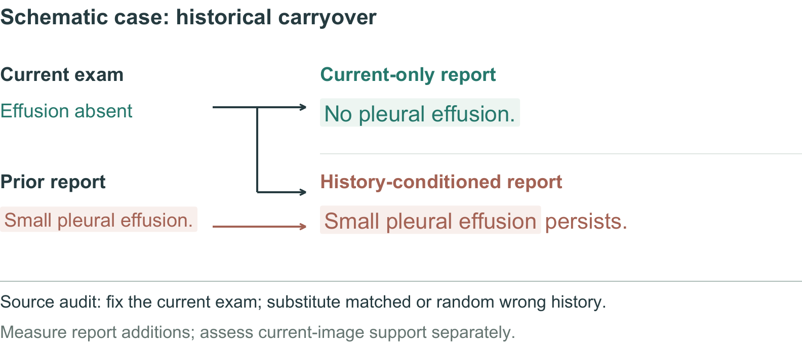
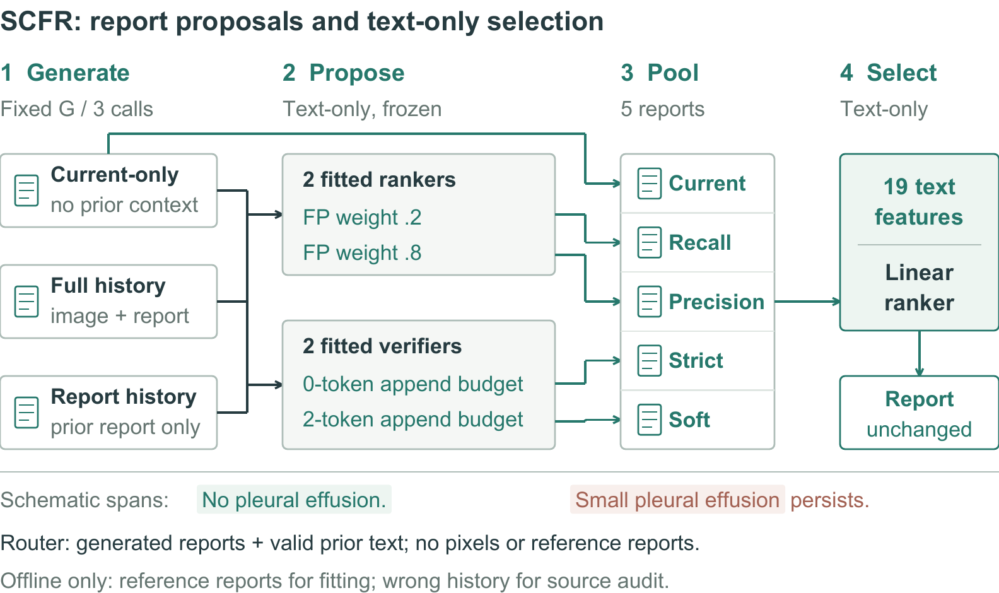

# SCFR: Source-Causal Finding Router

Code for [Source-Causal Control of Historical Context in Longitudinal Radiology Report Generation](https://neurips.cc/virtual/2026/poster/154092), by Dmitry Lvov and Ilya Pershin. NeurIPS 2026 Main Track, poster. [OpenReview](https://openreview.net/forum?id=GHvYdC6tmg).

Historical context can help a radiology report generator, but it can also carry an old finding into the current report. SCFR holds the current examination fixed, audits sensitivity to historical sources, and learns to select among reports constructed from valid current and prior information. It uses no reference report or wrong-patient history at inference.



## How it works

All three base reports describe the same current examination: `current_only` uses current images alone; `real_prior` uses current images, true prior images, and the true prior report; `prior_report_only` uses current images and the true prior report. The separate `prior_report` field holds the actual historical text. Two rerankers and two finding-verifier realizations produce alternative proposals. A linear router chooses between the current-only report and these four proposals using 19 text and source-consistency features. Wrong-history interventions are used only for analysis.



Both figures are vector schematics. Examination labels and report snippets illustrate the method; they are not evaluated cases. [Figure sources](assets/README.md).

## Quick start

Use Python 3.10 or newer. The CPU example needs no dataset, model download, or GPU:

```bash
git clone https://github.com/LvovDmitro/SCFR.git
cd SCFR
python -m venv .venv
source .venv/bin/activate
python -m pip install -e ".[verifier]"
python -B -m scfr_release demo --full --output-dir outputs/demo
python -B -m unittest discover -s tests -v
```

On Windows, activate with `.venv\Scripts\Activate.ps1`. The demo fits both proposal rerankers, both logistic verifiers, and the final router on synthetic text, then predicts four held-out examples. Its `receipt.json` records the software checks; `synthetic_model.json` and `predictions.json` contain the fitted bundle and selected reports. This checks fitting, JSON model export, and reference-free inference. A standard-library-only example is available with `demo` without `--full`.

## Use your own reports

SCFR operates on already generated reports. An inference input is a JSON list:

```json
[
  {
    "id": "example-1",
    "current_only": "No pleural effusion.",
    "real_prior": "Pleural effusion is present.",
    "prior_report_only": "Pleural effusion is present.",
    "prior_report": "Pleural effusion was present."
  }
]
```

Training rows additionally need a nonempty `reference`, a `subject_id`, and a `split` of `component_train`, `meta_train`, or `test`. Subjects must not cross splits. Component proposals fit on `component_train`; the router fits on `meta_train`. The default minimum is 20 rows in each training split. Keep references out of inference files.

```bash
python -B -m scfr_release train --input /authorized/training.json --output /authorized/model.json
python -B -m scfr_release infer --input /authorized/inference.json --model /authorized/model.json --output /authorized/predictions.json
python -B -m scfr_release evaluate --predictions /authorized/predictions.json --references /authorized/references.json --output /authorized/metrics.json
```

`/authorized` means your access-controlled storage. The reference file is a JSON list of `{"id": "example-1", "reference": "..."}` objects. Evaluation requires identical, unique ID sets and reports the paper's 11-finding rule-based proxy metrics. These are not clinical ground truth.

### Archived final-router weights

[models/scfr_controller_vectors_full_precision.json](models/scfr_controller_vectors_full_precision.json) contains the three archived 19-coefficient final-router vectors. To use one with precomputed proposals, add `cand_fp02`, `cand_fp08`, `verifier_t0`, and `verifier_t2` report strings to each inference row:

```bash
python -B -m scfr_release route --input /authorized/candidates.json --panel locked1000 --output /authorized/selected.json
```

Routing uses only the supplied reports and valid prior text. Paper panels map to the archived vector names as follows:

| Paper panel | `--panel` value |
|---|---|
| A | `seed1221` |
| B | `seed911` |
| C | `locked1000` |

Use `train` to fit new proposal/verifier/router models. Applying an archived router to newly fitted proposals is a new fit, distinct from the historical experiment; the [reproduction guide](REPRODUCIBILITY.md#archived-router-inference) describes exact-replay inputs.

## Reproduce the experiments

[REPRODUCIBILITY.md](REPRODUCIBILITY.md) gives the fitting settings, generator environments, input formats, and commands for each experiment. [evidence/](evidence/) contains reviewed aggregate comparison tables and their provenance. Every executable module documents its options with `--help`.

The CPU workflow and tests run on synthetic text. Paper experiments require authorized MIMIC-CXR data and the corresponding historical model and study artifacts described in the guide. Patient data, per-case predictions, restricted split manifests, and reader responses are not distributed here.

Use the official dataset access process and retain its data-use restrictions. Keep patient-derived reports and predictions in protected storage, including after removing identifiers. For model-specific dependencies, separate environments, and upstream-code licensing, see the [reproduction guide](REPRODUCIBILITY.md#generator-environments). This is research code, not a clinically validated system.

## Citation and license

```bibtex
@inproceedings{lvov2026sourcecausal,
  title={Source-Causal Control of Historical Context in Longitudinal Radiology Report Generation},
  author={Lvov, Dmitry and Pershin, Ilya},
  booktitle={Advances in Neural Information Processing Systems},
  year={2026},
  url={https://openreview.net/forum?id=GHvYdC6tmg}
}
```

The code is [MIT licensed](LICENSE). Dataset, pretrained-model, and third-party-code licenses apply separately. Machine-readable citation metadata is in [CITATION.cff](CITATION.cff).
